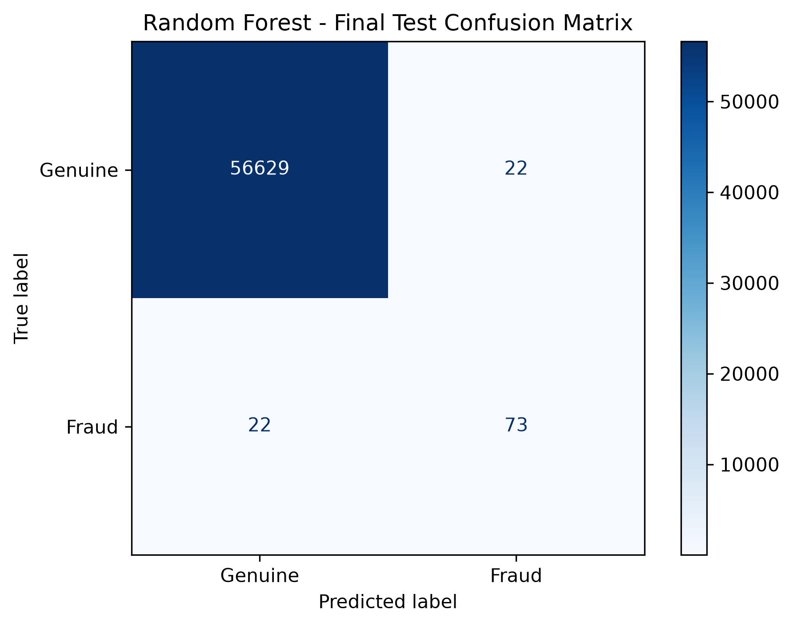
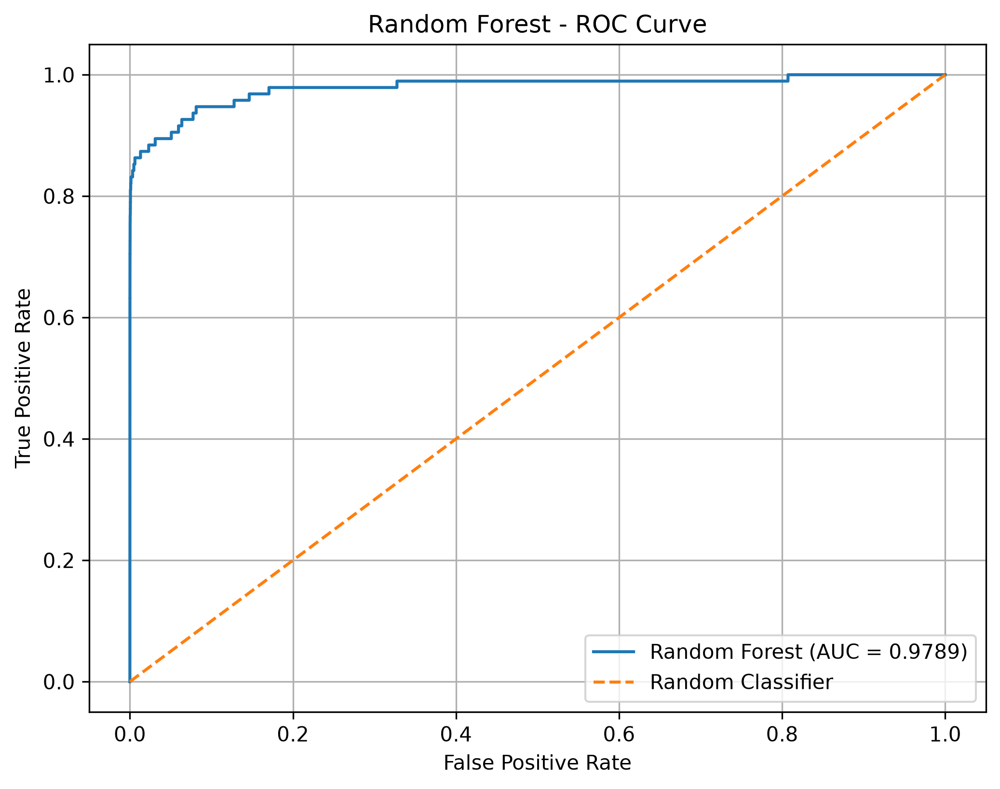
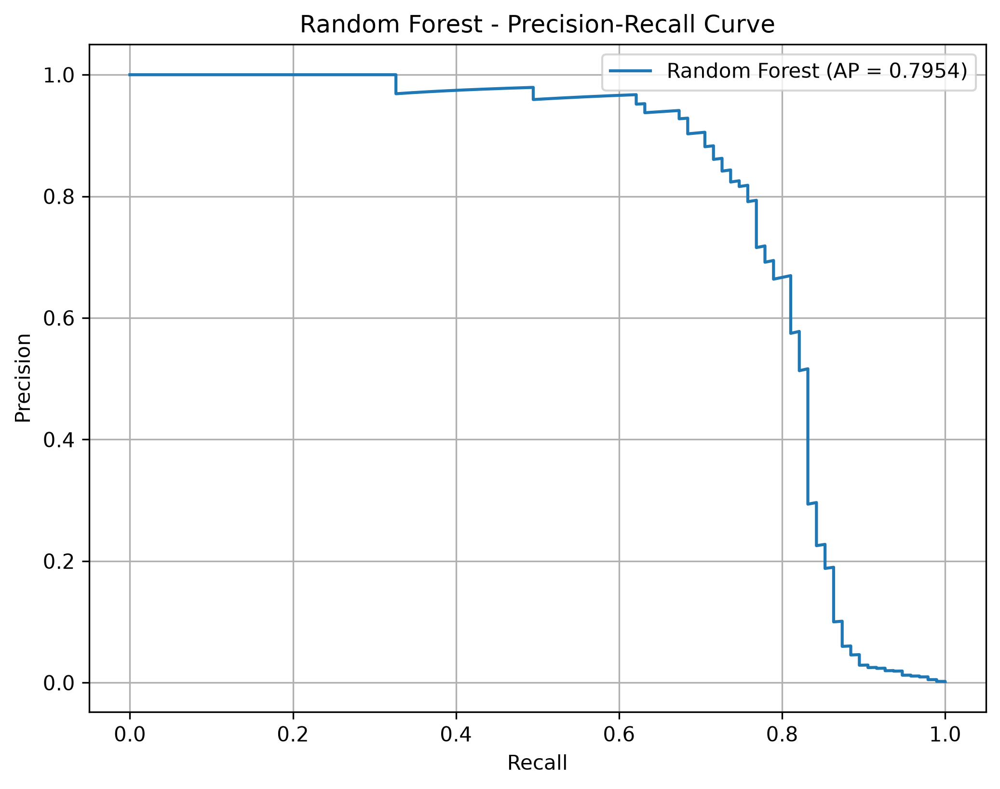
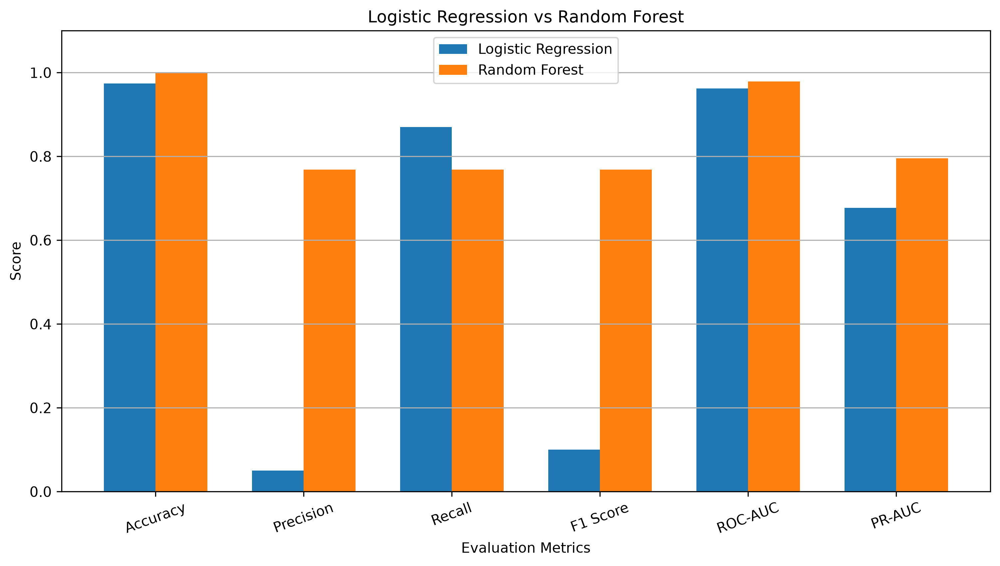

# Credit Card Fraud Detection Using Machine Learning

## 1. Project Overview

Credit card fraud is a major problem in the financial industry. Detecting fraudulent transactions accurately is challenging because fraudulent transactions represent only a very small percentage of all transactions.

This project uses Machine Learning techniques to identify potentially fraudulent credit card transactions.

Two classification algorithms, Logistic Regression and Random Forest, are implemented and evaluated. Their performance is compared using multiple evaluation metrics to identify the better-performing model.

The project also explores class imbalance handling, feature scaling, SMOTE, and classification threshold tuning.

## 2. Project Objectives

- Analyze credit card transaction data.
- Understand the problem of imbalanced datasets.
- Perform exploratory data analysis (EDA).
- Preprocess the dataset for machine learning.
- Handle class imbalance using SMOTE.
- Train Logistic Regression and Random Forest models.
- Evaluate models using appropriate classification metrics.
- Tune the classification threshold to improve fraud detection performance.
- Compare the models and visualize their results.

## 3. Dataset

**Dataset:** Credit Card Fraud Detection

**Source:** [Kaggle - Credit Card Fraud Detection](https://www.kaggle.com/datasets/mlg-ulb/creditcardfraud)

The dataset contains transactions made by European cardholders in September 2013.

| Attribute | Description |
|---|---|
| Time | Seconds elapsed between each transaction and the first transaction |
| V1–V28 | Anonymized features obtained through PCA transformation |
| Amount | Transaction amount |
| Class | Target variable indicating genuine or fraudulent transactions |

**Target variable:**
- `0` – Genuine transaction
- `1` – Fraudulent transaction

**Dataset details after removing duplicate records:**
- Total transactions: 283,726
- Genuine transactions: 283,253
- Fraudulent transactions: 473
- Total features: 30

The dataset is highly imbalanced, with fraudulent transactions representing approximately 0.17% of the cleaned dataset.

The dataset is not included in this repository. Download it from Kaggle and place `creditcard.csv` inside `data/archive/`.

## 4. Technologies Used

- Python
- Pandas
- NumPy
- Matplotlib
- Seaborn
- Scikit-learn
- Imbalanced-learn
- Jupyter Notebook
- Git and GitHub

## 5. Project Structure

```text
Credit-Card-Fraud-Detection/
│
├── data/
│   └── archive/
│       └── creditcard.csv
│
├── notebooks/
│   ├── 01_exploratory_data_analysis.ipynb
│   ├── 02_data_preprocessing.ipynb
│   └── 03_model_training.ipynb
│
├── reports/
│   └── figures/
│       ├── confusion_matrix.png
│       ├── roc_curve.png
│       ├── precision_recall_curve.png
│       └── model_comparison.png
│
├── .gitignore
└── README.md
```

## 6. Project Workflow

### Step 1: Exploratory Data Analysis

- Loaded and inspected the dataset.
- Checked for missing values and duplicate records.
- Analyzed the distribution of genuine and fraudulent transactions.
- Examined transaction amounts and feature correlations.
- Visualized important patterns in the dataset.

### Step 2: Data Preprocessing

- Removed duplicate records.
- Separated input features and the target variable.
- Split the dataset into training and testing sets using stratified sampling.
- Applied StandardScaler to the `Time` and `Amount` features.
- Used SMOTE (Synthetic Minority Over-sampling Technique) to handle class imbalance.

The dataset was split into:
- Training set: 80%
- Testing set: 20%

SMOTE was applied only to the training data to avoid data leakage. The test dataset retained its original class distribution.

### Step 3: Model Training

Two machine learning algorithms were implemented.

**1. Logistic Regression**

Logistic Regression was used as a baseline classification algorithm to predict whether a transaction is genuine or fraudulent.

**2. Random Forest Classifier**

Random Forest uses multiple decision trees to make predictions. It was trained with the following parameters:

- Number of estimators: 100
- Maximum depth: 12
- Minimum samples per leaf: 2
- Random state: 42

### Step 4: Feature Importance Analysis

Random Forest feature importance was analyzed to identify which features contributed most to the model's predictions.

Some of the important features included:
- V14
- V10
- V12
- V17
- V4

### Step 5: Classification Threshold Tuning

The default classification threshold of 0.5 was not assumed to be optimal.

A separate validation dataset was used to evaluate different thresholds. The threshold of 0.6 was selected based on the best F1-score among the tested values.

The selected threshold was then used for the final Random Forest evaluation on the untouched test dataset.

### Step 6: Model Evaluation

The models were evaluated using:

- Accuracy
- Precision
- Recall
- F1-score
- ROC-AUC
- Precision-Recall AUC (Average Precision)

## 7. Model Performance Comparison

The following table compares the performance of Logistic Regression and Random Forest.

| Evaluation Metric | Logistic Regression | Random Forest |
|---|---:|---:|
| Accuracy | 97.37% | 99.92% |
| Precision | 5.00% | 76.84% |
| Recall | 87.00% | 76.84% |
| F1-score | 10.00% | 76.84% |
| ROC-AUC | 96.19% | 97.89% |
| PR-AUC | 67.69% | 79.54% |

**Note:** Logistic Regression was evaluated at a classification threshold of 0.5, whereas Random Forest was evaluated using the tuned threshold of 0.6. Therefore, the classification metrics are not a strictly like-for-like threshold comparison.

### Observations

- Logistic Regression achieved higher fraud recall but produced many false positives.
- Random Forest achieved considerably better precision and F1-score.
- Random Forest also achieved higher ROC-AUC and PR-AUC.
- Random Forest provided a better overall balance between detecting fraud and reducing false alarms in this experiment.

## 8. Final Random Forest Evaluation

The final Random Forest model was evaluated on the original, imbalanced test dataset using the selected threshold of 0.6.

| Metric | Final Result |
|---|---:|
| Accuracy | 99.92% |
| Precision | 76.84% |
| Recall | 76.84% |
| F1-score | 76.84% |
| ROC-AUC | 97.89% |
| PR-AUC | 79.54% |

### Final Confusion Matrix

| | Predicted Genuine | Predicted Fraud |
|---|---:|---:|
| Actual Genuine | 56,629 | 22 |
| Actual Fraud | 22 | 73 |

**Interpretation:**
- 56,629 genuine transactions were correctly identified.
- 22 genuine transactions were incorrectly flagged as fraudulent.
- 73 fraudulent transactions were correctly detected.
- 22 fraudulent transactions were missed.

The model successfully detected 73 out of 95 fraudulent transactions in the test dataset.

## 9. Model Evaluation Visualizations

### 9.1 Confusion Matrix

The confusion matrix shows the number of correctly and incorrectly classified genuine and fraudulent transactions.



### 9.2 ROC Curve

The ROC curve illustrates the relationship between the True Positive Rate and False Positive Rate at different classification thresholds.

**ROC-AUC: 0.9789**



### 9.3 Precision-Recall Curve

The Precision-Recall curve shows the trade-off between precision and recall at different classification thresholds. It is particularly useful for evaluating models on highly imbalanced datasets.

**Average Precision: 0.7954**



### 9.4 Model Comparison

This visualization compares Logistic Regression and Random Forest across six evaluation metrics.



## 10. Key Learnings

Through this project, I learned:

- Exploratory Data Analysis and data visualization.
- Data cleaning and preprocessing.
- Handling imbalanced datasets using SMOTE.
- Training classification models using Scikit-learn.
- Understanding Logistic Regression and Random Forest.
- Evaluating classification models using precision, recall, F1-score, ROC-AUC, and PR-AUC.
- Feature importance analysis.
- Classification threshold tuning.
- Avoiding data leakage during model training and evaluation.
- Maintaining and documenting a machine learning project using GitHub.

## 11. Conclusion

This project demonstrates how machine learning can be applied to credit card fraud detection.

Both Logistic Regression and Random Forest were implemented and evaluated. Based on the experimental results, Random Forest achieved better overall performance, with a final F1-score of 76.84% and ROC-AUC of 97.89%.

The project also highlights the importance of handling imbalanced datasets, selecting suitable evaluation metrics, and tuning classification thresholds.

**Future Improvements:**
- Experiment with additional machine learning algorithms.
- Perform hyperparameter tuning.
- Explore additional techniques for handling class imbalance.
- Improve fraud detection recall while controlling false positives.

---

**Project Type:** Machine Learning | Classification | Fraud Detection

**Repository:** [Credit Card Fraud Detection](https://github.com/bharghavguru/Credit-Card-Fraud-Detection)